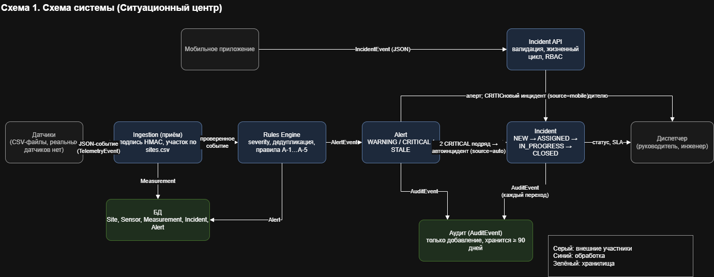
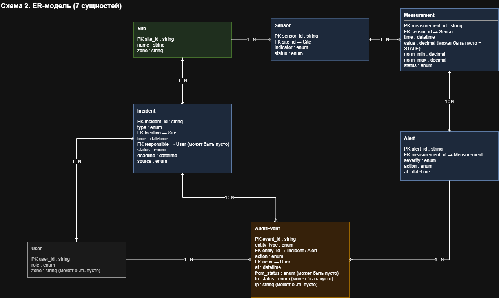
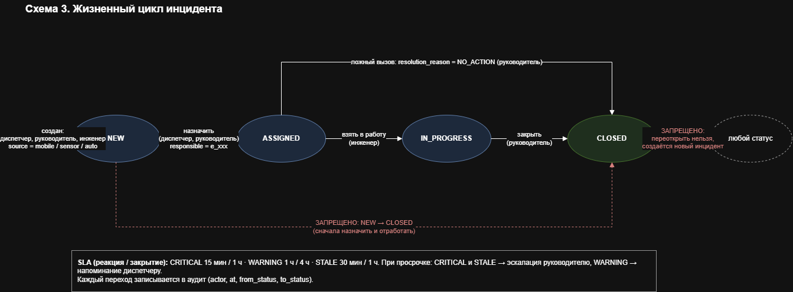

# Приложение — кейс 4

## A. Диаграммы

### A.1. Схема системы (обязательно)

5–6 блоков: Датчики → Ingestion → Rules Engine → Alert → Incident → Диспетчер.
Стрелки — потоки данных. Подписи: JSON-событие, алерт, статус.

### A.2. ER-модель (если делаете 08\_ER.md)

7 сущностей: Site, Sensor, Measurement, Incident, Alert, AuditEvent, User.

### A.3. Жизненный цикл инцидента

NEW ──assign──► ASSIGNED ──start──► IN\_PROGRESS ──resolve──► CLOSED
│
└──false-alarm──► CLOSED (NO\_ACTION)
text
Запрещено: NEW → CLOSED, CLOSED → любой.

### A.4. Схема потоков данных

Датчики → Ingestion → Rules Engine → Alert → авто-инцидент
↓
Мобильное приложение → Incident API → Lifecycle → Assignment
↓
AuditEvent

## B. Таблицы

### B.1. Правила оповещений (A-1…A-5)

|ID|Условие|Действие|severity|
|-|-|-|-|
|A-1|value < norm\_min или value > norm\_max|создать алерт|WARNING|
|A-2|отклонение > 10% от нормы|эскалировать|CRITICAL|
|A-3|2 подряд CRITICAL по одному датчику (`location+indicator`) в окне 15 мин |создать автоинцидент (`source=auto`), type=показатель датчика|CRITICAL|
|A-4|нет данных > 5 минут (value - пустое)|создать алерт и эскалировать руководителю|STALE|
|A-5|дубль события (тот же `location + indicator` в окне 5 мин)|не создавать второй алерт(`deduplicate`)|-|

### B.2. Формула severity

deviation\_pct = (value - norm\_max) / norm\_max × 100 # при превышении
или (norm\_min - value) / norm\_min × 100 # при недоборе

Если 0 < deviation\_pct ≤ 5: severity = WARNING (наблюдение)
Если 5 < deviation\_pct ≤ 10: severity = WARNING (реагирование)
Если deviation\_pct > 10: severity = CRITICAL (реагирование)
Если value = "" или нет данных: severity = STALE (эскалация руководителю)
Если norm\_min ≤ value ≤ norm\_max: severity = NORMAL

Примеры:
27.0°C при norm_max=26.0 → deviation = (27-26)/26 × 100 = 3.8% → WARNING (наблюдение).
28.3°C при norm_max=26.0 → deviation = (28.3-26)/26 × 100 = 8.8% → WARNING (реагирование).
29.5°C при norm_max=26.0 → deviation = (29.5-26)/26 × 100 = 13.5% → CRITICAL.
18.0°C при norm_min=20.0 → deviation = (20-18)/20 × 100 = 10% → WARNING (реагирование).
19.5°C при norm_min=20.0 → deviation = (20-19.5)/20 × 100 = 2.5% → WARNING (наблюдение).

Комментарий:
В исходных данных indicators.csv 6 строк с температурой 26 градусов при norm_max = 26.0 помечены WARNING, хотя, если расчитать по формуле, отклонение от нормы составляет 0%, что является нормой. 
Что предлагаем: считаем это как особенность исходных данных. 

### B.3. SLA

|severity|Реакция|Закрытие|Просрочка|
|-|-|-|-|
|CRITICAL|15 мин|1 ч|эскалация руководителю|
|WARNING|1 ч|4 ч|напоминание диспетчеру|
|STALE|30 мин|1 ч|эскалация руководителю|

### B.4. Роли (RBAC)

|Действие|Диспетчер|Руководитель|Инженер|Администратор|
|-|-|-|-|-|
|Создать инцидент|да|да|да|нет|
|Назначить ответственного|да|да|нет|нет|
|Перевести в IN\_PROGRESS|нет|нет|да|нет|
|Закрыть инцидент|нет|да|нет|нет|
|Переоткрыть CLOSED|нет|нет|нет|нет|
|Просмотр своего участка|да|да|да|нет|
|Просмотр всех участков|да|да|нет|да|
|Изменить справочник sites|нет|нет|нет|да|
|Читать аудит|нет|да|нет|да|
|Удалить аудит|нет|нет|нет|нет|

### B.5. Тесты (T4-1…T4-5)

## T4-1. Инцидент создан и назначен (ОБРАЗЕЦ)

**Вход:**
Создать инцидент {type: temperature, location: site\_01,
responsible: e\_101, status: NEW}
Затем: transition to ASSIGNED (диспетчер)

**Ожидание:**

* Инцидент `inc\_001` создан со статусом NEW
* После назначения — статус ASSIGNED, `responsible = e\_101`
* В аудите 2 записи: `incident\_created`, `incident\_assigned`

**Факт:** Инцидент успешно создан. При попытке перехода в ASSIGNED диспетчером, статус изменился, ответственный записался как e_101. В файле audit_out.csv появились две записи: incident_created и assigned.

**Пройден:** \[x] да  \[ ] нет

**Если нет — что исправить:** \_\_\_\_\_\_\_\_\_\_\_

## T4-2. Датчик превысил порог

**Вход:** строка из `indicators.csv` с `value = 28.3`, `norm\_max = 26.0`, `indicator = temperature`, `location = site\_02`

**Ожидание:**

* deviation\_pct = (28.3 - 26) / 26 × 100 ≈ 8.8% → severity = WARNING
* Создан алерт `severity = WARNING`
* Запись в alerts\_out.csv

**Факт:** Gри value=28.3, norm_max=26.0: deviation_pct=8.85%, severity=WARNING, 
action=ALERT_CREATED. Строка создана в alerts_out.csv.
**Пройден:** \[x] да  \[ ] нет

**Если нет — что исправить:** \_\_\_\_\_\_\_\_\_\_\_

## T4-3. Неверные данные отклонены

**Вход:** инцидент с `location = ""` или `location = site\_99` (не из sites.csv)

**Ожидание:**

* 422 VALIDATION\_ERROR
* В `details`: `field=location, code=UNKNOWN\_LOCATION`
* Инцидент не создан

**Факт:** 1. Датчики (indicators): создан файл test_t4_3.csv с site_99. Программа выдала ошибку "site_99: UNKNOWN_LOCATION", алерт не создан. 2. Инциденты (incidents): использован файл test_incidents.csv от разработчика (содержит site_99). Программа выдала ошибку "Инцидент inc_001: site_99 — UNKNOWN_LOCATION", инцидент отклонен
**Пройден:** \[x] да  \[ ] нет

**Если нет — что исправить:** \_\_\_\_\_\_\_\_\_\_\_

## T4-4. Повтор события (дедупликация)

**Вход:** два события с одинаковыми `location + indicator` в течение 5 минут

**Ожидание:**

* Второе событие → `DUPLICATE`
* Не создаёт второй алерт
* В alerts\_out.csv одна запись, не две

**Факт:** два события site_01/temperature с разницей 2 мин → одна запись. 
С разницей 10 мин → две записи. Окно 5 минут работает
**Пройден:** \[x] да  \[ ] нет

**Если нет — что исправить:** \_\_\_\_\_\_\_\_\_\_\_

## T4-5. Датчик offline / STALE

**Вход:** строка с `value = ""` и `status = STALE` в indicators.csv

**Ожидание:**

* Алерт `severity = STALE`
* Эскалация руководителю (в alerts\_out.csv `action = ESCALATED`)
* Не создаётся обычный CRITICAL

**Факт:** При обработке строк с пустым value (site_03 и site_04) созданы алерты с severity = STALE и action = ESCALATED. Обычный CRITICAL для этих событий не создавался, данные зафиксированы в alerts_out.csv
**Пройден:** \[x] да  \[ ] нет

**Если нет — что исправить:** \_\_\_\_\_\_\_\_\_\_\_

## C. Журнал промптов

1. Ягафарова Р.М.

| Дата | Цель | Промпт (сжато) | Результат | Проверка | Использовано |
|---|---|---|---|---|---|
| 06.11.2026 | Собрать рабочую версию прототипа | Сверь `04_прототип.py` с файлами `02` и `07`: валидация, эмуляторы БКИ и СМЭВ, скоринг, правила отказа, журналы. Ничего не добавляй от себя. | Первая полная версия конвейера: чтение CSV, оба режима, `decisions.csv`, `audit.log`, `external.log`. | Прогон на 100 заявках, ручная сверка `reason` с порядком правил. | Да |
| 06.11.2026 | Ревью `06_external_services.md` | Сверь описание СМЭВ, таймаутов и полей `external.log` с кодом. Покажи расхождения. | Список расхождений: поля ответа, поведение при `TIMEOUT`, формат журнала. | Сверка с фактическими строками `external.log`. | Переработано |
| 06.11.2026 | Ревью вывода и журналов | Почему `decisions.csv` и `audit.log` расходятся по формату? Проверь заголовки, поля и порядок строк. | Исправлен вывод: единые поля решения, повторный чистый прогон. | Сравнение `decisions.csv`, `audit.log` и решений по 100 заявкам. | Да |
| 06.11.2026 | Заполнить факты по тестам | Проверь 5 сценариев `T2-1`–`T2-5` по прогону. Заполни фактические результаты и объясни расхождение `app_0005`. | В `03_тесты.md` заполнены фактические результаты; объяснено расхождение `HIGH_DTI` и `AMOUNT_LIMIT`. | Ручной прогон и сверка `reason` с правилами. | Да |
| 06.11.2026 | Ручная правка прототипа после ревью | Найди слабые места в `validate` и `decide`: пустые поля, границы, порядок проверок. | Внесены правки: приоритет проверок, граничные случаи, тексты для клиента. | Повторный прогон и проверка 5 тестовых заявок. | Да |
| 06.11.2026 | Ревью требований и внешних сервисов | Сверь FR с фактическим кодом и файлом `06`. Убери обещания, которых нет в прототипе. | Скорректированы `04_requirements.md` и `06_external_services.md`. | Построчная сверка с кодом и журналами. | Переработано |
| 06.11.2026 | Проверить причины отказа | ИИ предложил добавить в `08_reasons.md` коды `MISSING_*` и `*_OUT_OF_RANGE`. Проверь, можно ли так делать. | Предложение отклонено: в `08` оставлены только причины из разметки; коды валидатора относятся к `data_dictionary.md`. Из кода убраны лишние тексты. | Сверка с FR-2: собственные коды причин вводить нельзя. `08` не изменялся. | Нет |
| 06.11.2026 | Интерактивный режим | Доработай консоль: вопросы со значениями по умолчанию, понятные ошибки ввода, выход без traceback. | Добавлен диалоговый режим, отмена ввода и понятные сообщения об ошибках. | Ручной прогон: пустой ввод, `q`, `Ctrl+C`, неверный путь. | Да |
| 07.11.2026 | Переименование данных от организаторов | Организаторы переименовали CSV в `application.csv` и `product.csv`. Найди все ссылки на старые имена и проверь запуск. | Исправлены пути и fallback в коде, обновлены ссылки в документах. | Запуск на `application.csv`, проверка отсутствия старого имени. | Да |
| 07.11.2026 | Рефакторинг после правок правил | Собери прототип заново: dataclass-структуры, отдельные функции, CLI, журналы. Поведение не менять. | Выполнен рефакторинг `04_прототип.py`, обновлены `05_api_schemas.yaml`, `04` и `06`. | Проверка синтаксиса, прогон на 100 заявках, сверка с прежним результатом. | Да |
| 07.11.2026 | Финальная проверка | Прогони оба режима, покажи расхождения с разметкой и почисти старые логи. | Обычный режим: 60/100; режим сверки: 78/100; выявлено 22 расхождения, логи перегенерированы. | Построчное сравнение, разбор `app_0005` и `app_0007`. | Да |

2. Сельскова А.Д.

| Дата | Цель | Текст промпта | Результат | Проверка | Использовано |
|---|---|---|---|---|---|
| 02.11.2026 | Понять объём работы аналитика | Прикрепила проектное задание. Указала, что я неопытная первокурсница, и попросила составить подробный план действий по созданию необходимых артефактов: требований, ER-модели, API и бизнес-правил. | Составлен план работы с перечнем документов, последовательностью действий и зависимостями между ними. | Сверка плана с проектным заданием. | Да |
| 02.11.2026 | Формализовать бизнес-правила | Помоги описать правила A-1–A-5, уровни Severity, жизненный цикл инцидента, роли, SLA и дедупликацию.| Подготовлена структурированная версия бизнес-правил и связанных ограничений. | Сверка с исходным заданием. Самостоятельное написание правил на основе сгенерированных.| Да |
| 03.11.2026 | Подготовить функциональные и нефункциональные требования | Составь FR и NFR с уникальными ID, критериями приёмки и связью с бизнес-правилами и тестами. Не добавляй неподтверждённые функции. | Подготовлена структура требований с идентификаторами и критериями проверки. | Сверка с правилами и проектным заданием. | Да |
| 04.11.2026 | Разработать API-контракты | Помоги описать API в YAML | Подготовлен черновик API-контрактов. | Проверка согласованности полей и примеров с правилами. | Да |
| 04.11.2026 | Проверить согласованность API и ER-модели | Проведи аудит API: сравни его с ER-моделью и бизнес-правилами, найди несовпадения и предложи исправления. | Составлен список расхождений и рекомендаций по исправлению. | Ручная сверка связанных документов. | Да |
| 08–09.11.2026 | Провести комплексную проверку проекта | Сравни `02_правила.md`, `09_требования.md`, `10_API.yaml`, `08_ER.md` и Python-прототип. Найди противоречия между документами и реализацией. | Подготовлен перечень несоответствий и приоритетных доработок. | Сверка документов между собой и с кодом прототипа. | Да |
| 09.11.2026 | Подготовиться к защите архитектуры | Помоги подготовить объяснение простым языком.| Подготовлены пояснения по аналитике. | Сверка с актуальными документами и прототипом. | Да |

3. Старая В.В.

| Дата | Цель | Текст промпта | Результат | Проверка | Использовано |
|---|---|---|---|---|---|
| 06.11.2026 | Разбор архитектуры шаблона | Объясни, как устроен предложенный шаблон `04_прототип.py`. Куда передаются данные из `main` и как они доходят до записи в файл? | Схема потока данных: CSV → `main` → `check_indicator` → `write_alert`. | Сверили с исходным кодом, прошлись по строкам вручную. | Да, использовано для понимания архитектуры перед доработкой. |
| 06.11.2026 | Отладка дедупликации (A-5) | Я написала логику дедупликации через `datetime`. Проверь, почему при разнице во времени может сломаться окно в 5 минут и как лучше считать секунды. | Совет использовать `total_seconds()` и добавить сортировку по времени. | Добавили `rows.sort()` в `main`. Проверили на T4-4: в файле ровно 24 алерта, дублей нет. | Да, переработано и внедрено. |
| 06.11.2026 | Исправление ошибки `OUT_OF_BOUNDS` | Почему программа выдаёт ошибку `OUT_OF_BOUNDS` и 0 алертов? | Объяснение, что проверки выхода за норму дублируют `calc_severity` и возвращают `ERROR` вместо `WARNING`/`CRITICAL`. | Удалили лишние проверки, перезапустили программу — появилось 24 алерта. | Да, исправлен код. |
| 06.11.2026 | Реализация RBAC | Подскажи синтаксис Python, как реализовать проверку ролей через словарь, исходя из моей таблицы из `02_правила.md`? | Структура словаря `ALLOWED_ROLES` и логика проверки `actor_role`. | Адаптировали под роли (диспетчер, менеджер, инженер) и проверили встроенными тестами. | Да, адаптировано под свой код. |
| 07.11.2026 | HMAC и `os.environ` | Объясни принцип работы `os.environ` и как написать заглушку проверки HMAC, если в исходных CSV нет поля `signature`? | Функция `verify_signature` с `hmac.compare_digest` и fallback-ключом. | Убедились, что код не падает без колонки `signature`. По правилам ИБ секрет не должен быть захардкожен. | Да, переработано. |
| 09.11 | Демо HMAC-подписи (ИБ) | «Как сгенерировать тестовую таблицу с валидной и подменённой подписью, чтобы проверить ошибку `SENSOR_SIGNATURE_INVALID`?» | Скрипт генерации `test_hmac.csv` с двумя строками (оригинал и подмена) | Запустили прототип с `--indicators test_hmac.csv`. Убедились, что подменённая строка отклонена с ошибкой `SENSOR_SIGNATURE_INVALID` | да, скрипт использован для создания демо-данных |

## D. Матрица вклада

|Участник|Файлы / задачи|Часы|Подпись|
|-|-|-|-|
|Сельскова А.Д.|02\_правила.md, 09\_требовпния.md, 10_API.yalm |10|\_\_\_\_\_\_|
|Старая В.В. |04\_прототип.py, отладка|12|\_\_\_\_\_\_|
|Феткулова А.Р.|05\_презентация.pdf, 06\_приложение.pdf|7|\_\_\_\_\_\_|
|Ягафарова Р.М.|08\_ER.md, журнал ИИ, 11\_ИБ.md, README.md|9|\_\_\_\_\_\_|
|Горбунова А.В.|тесты|7|\_\_\_\_\_\_|

## E. Артефакты

* Ссылка на Git-ветку `https://github.com/thettis/situation-center-case4/tree/team_4_case_4`.
* Скриншот последнего коммита.

* Скриншот вывода прототипа на T4-2 и T4-5.

* `md5sum 01\_данные/indicators.csv` (данные не менялись). Хэш: 74bef253784c98e2afbbb9a9fe910226

## F. Чек-лист приложения

* \[x] Схема системы (A.1)
* \[x] ER-модель (A.2) или перечисление сущностей
* \[x] Жизненный цикл (A.3)
* \[x] Схема потоков (A.4)
* \[x] Правила A-1…A-5 (B.1)
* \[x] Формула severity + пример (B.2)
* \[x] SLA (B.3)
* \[x] RBAC (B.4)
* \[x] Тесты (B.5)
* \[x] Журнал промптов (C)
* \[x] Матрица вклада (D)
* \[x] Git + скрины (E)
* \[x] Экспорт в PDF до защиты

